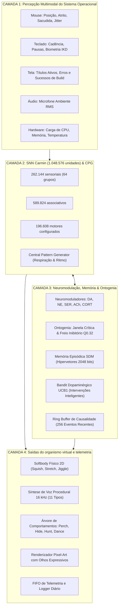

<div align="center">

# 🧠 Carmin — Organismo Digital Autônomo v1.6.0
<sub>Repositório e executáveis ainda preservam o nome histórico Caddin.</sub>
### Runtime C11 com rede LIF configurada para 1.048.576 unidades, 120 grupos, conectividade CSR limitada, sensores de desktop, SDM e ontogenia

[-blue.svg)](#)
[](#)
[](#)
[](#)
[](docs/carmin/BASELINE.md)
[%20%7C%20Windows%20(GDI%20%2B%20WinMM)-blueviolet.svg)](#)
[](#)

</div>

---

## 📖 Apresentação

**Carmin** é a identidade do produto em evolução deste repositório Caddin. O runtime atual combina sensores do desktop, um modelo LIF e camadas de memória, ontogenia, homeostase e comportamento, com backends Linux/X11 e Windows. A SNN ativa está configurada para **1.048.576 unidades em 120 grupos**: 262.144 sensoriais, 589.824 associativas e 196.608 motoras. A conectividade é montada diretamente em CSR, com no máximo 64 conexões de saída por unidade.

Esse total descreve unidades com estado alocado e IDs em pools; **não é uma alegação de 60 FPS ou tempo real geral**. O kernel neural integra por eventos e avança células silenciosas de forma lazy. Num benchmark fixo neste host, o ciclo de estímulo + `brain_step(16 ms)` + STDP levou 4,70 ms em carga média e 26,37 ms em carga alta; a referência densa levou 51,13 ms e 66,17 ms, respectivamente. O processo event-driven atingiu pico entre 520 e 540 MiB de RSS. A carga alta excede o orçamento de 16 ms; os resultados de escala, hashes de estado e detalhes do método estão em [baseline](docs/carmin/BASELINE.md) e [curva 2k–1M](docs/carmin/CURVA_ESCALA.md). Validação comportamental, latência da aplicação completa e segundo hardware continuam pendentes. A reserva máxima de conectividade pelo teto seria 67.108.864 sinapses; esta topologia construiu 52.166.656.

O caminho ativo usa C11, CSR e vetores de estado no heap. A política atual continua centrada no organismo virtual e nos comportamentos já presentes. Controle geral de mouse/teclado, leitura/escrita arbitrária de arquivos, comandos do shell e ponte com LLM local são objetivos em planejamento, não capacidades que este release declara como prontas.

---

## 📑 Índice Geral

1. [Início Rápido e Execução](#-início-rápido-e-execução)
2. [Matriz Completa de Capacidades do Organismo](#-matriz-completa-de-capacidades-do-organismo)
3. [Arquitetura Neurobiológica em 4 Camadas](#-arquitetura-neurobiológica-em-4-camadas)
4. [Cérebro SNN de 1.048.576 Unidades e Topologia Neural](#-cérebro-snn-de-1048576-unidades-e-topologia-neural)
5. [Ciclo Ontogenético e Janela Crítica de Aprendizado](#-ciclo-ontogenético-e-janela-crítica-de-aprendizado)
6. [Memória Episódica SDM (Kanerva) & Curiosidade (Schmidhuber)](#-memória-episódica-sdm-kanerva--curiosidade-schmidhuber)
7. [Bandit Dopaminérgico UCB1 & Detecção de Fadiga Humana](#-bandit-dopaminérgico-ucb1--detecção-de-fadiga-humana)
8. [Maturação Vocal & Síntese Procedural Acústica (11 Tipos)](#-maturação-vocal--síntese-procedural-acústica)
9. [Física Elástica Softbody e Reações Mecânicas](#-física-elástica-softbody-e-reações-mecânicas)
10. [Percepção Contextual de Janelas, Código e Privacidade](#-percepção-contextual-de-janelas-código-e-privacidade)
11. [Rituais Circadianos e Marcos de Convivência](#-rituais-circadianos-e-marcos-de-convivência)
12. [Biometria de Digitação (IKD) & Resumo Diário de Foco](#-biometria-de-digitação-ikd--resumo-diário-de-foco)
13. [Monitor de Telemetria e Spikes em Terminal ANSI em 100% C](#-monitor-de-telemetria-e-spikes-em-terminal-ansi)
14. [Motor de Regras Customizáveis (.caddinrc)](#-motor-de-regras-customizáveis-caddinrc)
15. [Persistência Atômica v2 com Integridade CRC32](#-persistência-atômica-v2-com-integridade-crc32)
16. [Evolução Carmin: eventos, segurança e validação](#-evolução-carmin-eventos-segurança-e-validação)
17. [Estrutura de Diretórios do Projeto](#-estrutura-de-diretórios-do-projeto)
18. [Histórico de Versões e Evolução](#-histórico-de-versões-e-evolução)
19. [Guia de Compilação, Cross-Compile e Deploy](#-guia-de-compilação-cross-compile-e-deploy)
20. [Suíte de Testes Automatizada](#-suíte-de-testes-automatizada)
21. [Controles, Interações e Atalhos](#-controles-interações-e-atalhos)
22. [Licença](#-licença)

---

## 🚀 Início Rápido e Execução

### Linux (Nativo X11 + ALSA)
```bash
# 1. Instalar dependências básicas de compilação
sudo apt install gcc make cmake libx11-dev libxext-dev libasound2-dev

# 2. Clonar o repositório
git clone https://github.com/HololiveStudios/caddin.git
cd caddin

# 3. Compilar em modo Release
make

# 4. Executar os testes headless
make test

# 5. Iniciar o mascote
make run
```

### Monitor de Telemetria em Tempo Real (Terminal Separado, 100% C Puro)
```bash
# Permite assistir a atividade neural dos grupos ativos, ondas de neuromoduladores e fadiga
./build/caddin_monitor
```

### Windows (Compilação Cruzada via MinGW-w64 no Linux)
```bash
sudo apt install gcc-mingw-w64-x86-64 ninja-build cmake
make windows
# Binários gerados: build-windows/caddin.exe e build-windows/caddin_monitor.exe
```

---

## 🧬 Matriz Completa de Capacidades do Organismo

| Dimensão | Componente Interno | Funcionamento e Especificação Técnica |
|---|---|---|
| **Cérebro Spiking** | 1.048.576 unidades LIF configuradas | 64 grupos sensoriais (262.144), 32 associativos (589.824) e 24 motores (196.608). Conectividade CSR amostrada com teto de 64 saídas por unidade. |
| **Ontogenia Biológica** | 120 Pools Ontogenéticos | Maturação em 4 estágios (*Filhote, Juvenil, Adulto, Veterano*). Freio da janela crítica com aritmética Q0.32 e cristalização de projeções estáveis para `int8`. |
| **Memória Episódica** | SDM Hiperdimensional | Sparse Distributed Memory de Kanerva com hipervetores de 2048 bits ($32 \times \text{uint64\_t}$). Conclusão de padrão resistente a ruído e poda sináptica no sono. |
| **Curiosidade Intrínseca** | Princípio de Schmidhuber | Injeção de dopamina por progresso de compressão temporal ($\Delta \text{err} < -2$). Elevação do drive de exploração quando o ambiente está estagnado. |
| **Inteligência Contextual** | Bandit UCB1 | Exploração vs. exploração de intervenções ergonômicas baseadas no perfil de fadiga e aceitação implícita do usuário. |
| **Visão & Desktop** | Percepção de Texto X11/Win32 | Monitoramento em tempo real do contexto de tela com detecção nativa de erros (`segfault`, `panic`) e sucessos de compilação (`passed`, `build completed`). |
| **Audição Acústica** | Captura de Microfone ALSA | Processamento RMS não-bloqueante; reage a sons súbitos, palmas e intensidade da fala humana. |
| **Biometria de Teclado** | Keystroke Biometrics IKD | Reconhece o dono pela cadência de digitação (Inter-Keystroke Delay em 16 bins), elevando serotonina com o dono e noradrenalina com estranhos. |
| **Física Softbody** | Dinâmica Elástica 2D | Equação massa-mola amortecida contínua com deformações de *Squish*, *Stretch*, *Shear* e expansão respiratória acoplada ao CPG. |
| **Voz Sintética** | Modelagem Acústica 16 kHz | 11 tipos de vocalizações sintetizadas proceduralmente (sem áudios gravados). Frequências fundamentais, harmônicos, vibrato, tremolo e ruído. |
| **Telemetria ANSI** | FIFO POSIX Não-Bloqueante | Emite telemetria binária a 10 Hz para visualização em terminal C puro (`caddin_monitor`). |
| **Resumo Diário** | Daily Summary Logger | Mantém métricas diárias agregadas de convivência, código e foco em `caddin_daily.log`. |
| **Privacidade Estrita** | Blacklist de Segurança | Ignora qualquer leitura de janela pertencente a gerenciadores de senhas (`bitwarden`, `keepass`, `1password`), bancos e sessões privadas. |
| **Personalização** | Parser `.caddinrc` | Configuração de regras ativas por nome de janela, horários de foco, injeção direta de neuromoduladores e ações físicas. |

---

## 🏛️ Arquitetura Neurobiológica em 4 Camadas



---

## 🧠 Cérebro SNN de 1.048.576 Unidades e Topologia Neural

A rede usa neurônios **LIF (Leaky Integrate-and-Fire)** e sinapses esparsas em formato **CSR (Compressed Sparse Row)**. O kernel por eventos integra somente alvos ativados e avança estados silenciosos quando voltam a receber entrada. A comparação com integração densa mostrou taxas observáveis iguais nos cenários fixos médio e alto; equivalência para outros estados e entradas ainda está em validação. Não há confirmação de 60 FPS nesta escala:

### 1. Grupos sensoriais (64 × 4.096 = 262.144 unidades)
Os 64 canais e suas populações-base estão em [`runtime_types.h`](runtime_types.h), [`network_data.h`](network_data.h) e no [inventário detalhado](docs/carmin/INVENTARIO_GRUPOS.md). Incluem digitação, interação, contexto temporal, sinais de sistema, temperatura, presença, biometria e sinais homeostáticos. As fontes disponíveis variam por plataforma; seis canais ainda não têm produtor confiável conectado.

### 2. Interneurônios Associativos (32 grupos × 18.432 = 589.824 unidades)
Pools de associação, memória de trabalho, estados afetivos, foco e controle. A tabela completa dos 32 grupos associativos contém nomes, perfis de dinâmica e projeções; confira o [inventário](docs/carmin/INVENTARIO_GRUPOS.md).

### 3. Grupos Motores (24 grupos × 8.192 = 196.608 unidades)
- **Expressão Facial:** `M_FACE_HAPPY`, `M_FACE_SAD`, `M_FACE_SLEEP`, `M_FACE_SURPRISED`, `M_FACE_ANGRY`, `M_FACE_CURIOUS`, `M_FACE_PLAYFUL`, `M_FACE_NEUTRAL`, `M_FACE_WINK`.
- **Atuação Vocal:** `M_CHIRP_SOUND`, `M_BEEP_PULSE`, `M_PURR_EFFECT`, `M_ALERT_EMIT`, `M_THINK_EMIT`.
- **Ações e comportamento existentes:** expressão, vocalização, sono, alimentação e movimentos do organismo virtual. Controle arbitrário de mouse/teclado e operações de arquivos/shell não fazem parte do runtime liberado.

A lista ativa de nomes, parâmetros, IDs, produtores e consumidores está em [`docs/carmin/INVENTARIO_GRUPOS.md`](docs/carmin/INVENTARIO_GRUPOS.md). O [mapa-alvo dos 120 grupos desktop](docs/carmin/MAPA_GRUPOS_DESKTOP.md) está especificado, mas ainda não foi ativado no runtime e não é uma capacidade deste release. Cada região possui estado LIF individual e a topologia a 1M foi construída com 52.166.656 sinapses observadas; o perfil desktop não aumenta nem substitui ainda as 1.048.576 unidades.

### 4. Neuromoduladores Biológicos
- **Dopamina (DA):** Sinal de recompensa, novidade e incentivo à exploração.
- **Noradrenalina (NE):** Sinal de alerta, foco súbito, surpresa e estresse agudo.
- **Serotonina (SER):** Saciedade, bem-estar, afeto consolidado e alívio pós-choque.
- **Acetilcolina (ACh):** Atenção seletiva, foco no trabalho e gravação de memória.
- **Cortisol (CORT):** Estresse crônico, fadiga e abandono prolongado.

---

## 🐣 Ciclo Ontogenético e Janela Crítica de Aprendizado

O módulo de ontogenia (`src/core/ontogeny.c/h`) opera com aritmética de ponto fixo `fix16_t` (Q8.8) e inteiros de 32 bits:

### 1. Freio Inibitório da Janela Crítica (`brake` Q0.32)
Para cada um dos 120 pools biológicos:
- A cada segundo de vigília, se o pool apresentar atividade mínima (`act_ema >= act_min`):
  - **Domínio de Padrões (`err_ema < theta_lo`):** O freio cresce proporcionalmente à precisão preditiva:
    $$\Delta = \left(\frac{2^{32}}{T}\right) \cdot m \cdot \text{act\_ema}$$
  - **Surpresa Crônica (`err_ema > theta_hi`):** O freio regride (reabrindo a plasticidade) em velocidade 4× mais lenta que o fechamento.
- **Taxa de Aprendizado Efetiva:**
  $$\text{lr} = \max(\text{piso}, 1 - \text{brake})$$
  *(Filhotes aprendem a 100%; veteranos retêm ~5% de piso para adaptações sutis).*

### 2. Estágios do Desenvolvimento
| Estágio | Maturidade Média | Comportamento e Fisiologia |
|---|---|---|
| **Filhote (`ONTO_FILHOTE`)** | $0\% \le \text{freio} < 25\%$ | Hiperativo, voz aguda ($1.35\times$), corpo elástico e macio, curiosidade elevada. |
| **Juvenil (`ONTO_JUVENIL`)** | $25\% \le \text{freio} < 60\%$ | Voz intermediária ($1.15\times$), formação de hábitos, consolidação no sono. |
| **Adulto (`ONTO_ADULTO`)** | $60\% \le \text{freio} < 90\%$ | Voz balanceada ($1.00\times$), temperamento firme, afeto consolidado ao dono. |
| **Veterano (`ONTO_VETERANO`)** | $90\% \le \text{freio} \le 100\%$ | Voz profunda ($0.88\times$), alta fidelidade, projeções cristalizadas em `int8`. |

---

## 💾 Memória Episódica SDM (Kanerva) & Curiosidade (Schmidhuber)

### 1. Sparse Distributed Memory (Hipervetores de 2048 Bits)
Implementada em `src/core/sdm.c/h`:
- **Álgebra de Hipervetores:** Operador Bind ($\otimes$) via XOR bit a bit em blocos de 64 bits (`uint64_t`) e Bundle ($\oplus$) via votação majoritária com contadores saturantes.
- **Conclusão de Padrão (Pattern Completion):** 128 hard locations distribuídas. O mascote recorda episódios passados mesmo com ruídos de até 15% nos estímulos de entrada.
- **Poda Sináptica Noturna:** Memórias registradas apenas uma vez decaem a zero durante o sono diário, liberando espaço para novos episódios.

### 2. Curiosidade Guiada por Progresso de Compressão
Baseado na teoria de Jürgen Schmidhuber:
$$\text{Progresso} = \text{Erro}_{t-1} - \text{Erro}_t$$
- **Aprendizado Ativo ($\Delta \text{err} < -2$):** Injeta Dopamina intrínseca por ter decodificado o ambiente.
- **Tédio por Estagnação ($\Delta \text{err} \approx 0$ com erro baixo):** O ambiente ficou previsível demais; eleva a curiosidade para estimular a exploração territorial.

---

## 🎰 Bandit Dopaminérgico UCB1 & Detecção de Fadiga Humana

### 1. Estimador de Fadiga do Usuário (`src/sense/sense_fatigue.c/h`)
Calcula a exaustão física e cognitiva baseando-se em:
- Horas contínuas de tela sem pausas.
- Cadência de digitação (keystrokes por segundo).
- Variância do intervalo entre teclas (irregularidade motora).
- Jitter e micro-tremores na velocidade do mouse.

### 2. Algoritmo UCB1 e Ações Empáticas
Quando a fadiga ultrapassa o limiar e respeitado um cooldown de 5 minutos, o mascote executa:
- `ARM_SILENT`: Observação discreta sem perturbação.
- `ARM_SUGGEST_PAUSE`: Deita-se e emite ronrom suave sugerindo descanso mútuo.
- `ARM_CHEER_PLAY`: Dá um pulo com som alegre de chirp para descontrair a mente.
- `ARM_STRETCH_WATER`: Espreguiça-se com jiggle elástico convidando a beber água.
- **Feedback Implícito:** Carinho após intervenção = $+1.0$; sacudida violenta = $-1.0$.

---

## 🎙️ Maturação Vocal & Síntese Procedural Acústica

A geração de som do Caddin opera a **16.000 Hz sem arquivos WAV ou MP3 em disco**. O áudio é sintetizado em tempo real com ondas senoidais, ruído branco (xorshift32), modulações de amplitude (AM) e envelopes biológicos ADSR.

| Identificador | Significado Biológico | Estrutura Acústica da Onda |
|---|---|---|
| `VOICE_PURR_CONTENT` | Carinho moderado | Onda de 68 Hz com AM triangular de 20 Hz e sopro suave. |
| `VOICE_PURR_DEEP` | Afeto prolongado / relaxamento | Onda fundamental de 55 Hz rica em 3 harmônicos e vibrato profundo. |
| `VOICE_TRILL` | Alegria efervescente / comemoração | Sequência de 3 chirps rápidos ascendentes (450→780 Hz). |
| `VOICE_CHIRP_HAPPY` | Resposta a toque gentil | Duas notas harmônicas (500 Hz e 660 Hz) com decaimento suave. |
| `VOICE_CHIRP_CURIOUS` | Curiosidade e inspeção | Sweep ascendente 380→760 Hz com vibrato progressivo. |
| `VOICE_GRUNT_IDLE` | Bocejo ou alívio | Sweep descendente 320→160 Hz com rouquidão gutural. |
| `VOICE_WHINE_PROTEST` | Saudade ou protesto suave | Descida tonal arrastada com vibrato melancólico. |
| `VOICE_GROWL_ANNOYED` | Irritação ou incômodo | Frequência de 160 Hz com harmônicos inarmônicos felinos. |
| `VOICE_HISS_ANGRY` | Raiva extrema / agressão | Ruído branco puro estocástico com envelope quadrático. |
| `VOICE_SQUEAK_STARTLED` | Susto agudo / choque súbito | Queda rápida 1300→550 Hz sem ataque para expressar sobressalto. |
| `VOICE_CRY_DISTRESS` | Angústia por solidão crônica | Vibrato profundo de $\pm 40$ Hz com soluços respiratórios. |

---

## 🍮 Física Elástica Softbody e Reações Mecânicas

O corpo do Caddin é modelado por um sistema contínuo de osciladores harmônicos amortecidos em 2D:

$$m \frac{d^2 x}{dt^2} + c \frac{dx}{dt} + k (x - x_0) = F_{\text{inércia}} + F_{\text{impacto}} + F_{\text{respiração}}$$

- **Squish (Compressão Vertical):** Amortece quedas e colisões contra as bordas da tela.
- **Stretch (Alongamento Vertical):** Ativado em impulsos de salto ou ao ser erguido pelo mouse.
- **Shear / Jiggle (Deformação Lateral):** Responde ao arrasto inercial do mouse e vibrações comemorativas.
- **Acoplamento Respiratório com CPG:** O Central Pattern Generator expande sutilmente o perímetro do mascote a cada ciclo respiratório.

---

## 👁️ Percepção Contextual de Janelas, Código e Privacidade

O sensor de texto (`src/sense/sense_text.c/h`) examina a janela do sistema operacional em foco:
- **Detecção de Erros de Código:** Reconhece `"error"`, `"failed"`, `"segfault"`, `"panic"`, `"exception"`. Causa injeção de noradrenalina/cortisol, achatamento corporal (squish) e som de resmungo (`VOICE_WHINE_PROTEST`).
- **Detecção de Sucessos de Build:** Reconhece `"success"`, `"passed"`, `"100%"`, `"completed"`. Gera pulso de dopamina/serotonina, salto com jiggle e trilo de alegria (`VOICE_TRILL`).
- **Lista Estrita de Privacidade:** Ignora títulos de gerenciadores de senhas (`bitwarden`, `keepass`, `1password`), janelas anônimas e termos bancários.

---

## 🌅 Rituais Circadianos e Marcos de Convivência

Gerenciados em `src/core/rituals.c/h`:
- **Saudações Circadianas:** Saudação afetuosa matinal entre 6h e 10h; recolhimento noturno suave após as 22h.
- **Marcos Históricos de Vigília:** Celebra marcos de convivência de **1 hora**, **10 horas**, **50 horas** e **100 horas** de vida acordado com dança comemorativa e trilos vocais.

---

## ⌨️ Biometria de Digitação (IKD) & Resumo Diário de Foco

- **Imprinting do Ritmo de Digitação (`src/sense/sense_keystroke_biometrics.c/h`):** Mede o atraso entre teclas (IKD) em 16 bins. Consolida o perfil do dono no sono (`caddin.keys`). Se a cadência for do dono (similaridade $> 0.85$), induz serotonina e afeto; se for de um estranho, induz alerta.
- **Resumo Diário de Produtividade (`src/core/daily_summary.c/h`):** Registra em `caddin_daily.log` e exibe no terminal ao fechar: horas de convivência, teclas digitadas, carinhos, sacudidas, builds de sucesso e intervenções de fadiga.

---

## 📊 Monitor de Telemetria e Spikes em Terminal ANSI

Utilitário executável compilado em **C11 puro** (`tools/caddin_monitor.c`):
- Conecta-se à FIFO `/tmp/caddin_telemetry.fifo` e plota em tempo real com cores ANSI 256:
  - Níveis gráficos de Dopamina, Noradrenalina, Serotonina e Cortisol.
  - Estágio de vida e porcentagem exata do freio ontogenético da janela crítica.
  - Matriz visual dos 120 pools e telemetria dos grupos ativos a 10 Hz.
  - Nível de fadiga e ações ativas do Bandit UCB1.

---

## 🎛️ Motor de Regras Customizáveis (.caddinrc)

Crie um arquivo `.caddinrc` na pasta do executável ou em `$HOME/.caddinrc`:

```ini
[privacy]
keepass
bitwarden
1password
private window
bank

# Se estiver compilando código no terminal, fica alerta e curioso
[rule:build_focus]
window = gcc
action = react_curious
param = 0.8
cooldown = 15.0

# Se estiver assistindo vídeos tarde da noite, induz calma
[rule:night_youtube]
window = youtube
hour_min = 23
hour_max = 6
action = inject_ser
param = 0.1
cooldown = 60.0

# Em editores de código, estimula dopamina e atenção
[rule:editor_flow]
window = code
action = inject_da
param = 0.08
cooldown = 30.0
```

---

## 🛡️ Persistência Atômica v2 com Integridade CRC32

Os snapshots usam gravação temporária e verificação de integridade; corrupção ou interrupção pode ser detectada, mas isso não equivale a rollback A/B de todos os arquivos:
- `caddin.brain`: Pesos sinápticos e topologia da rede SNN.
- `caddin.onto`: Estado ontogenético, estágios de vida e imprinting acústico.
- `caddin.sdm`: Memória episódica hiperdimensional distribuída.
- `caddin.bandit`: Modelo de aprendizado por reforço UCB1 de intervenções de fadiga.
- `caddin.keys`: Perfil biométrico de ritmo de digitação do dono.
- `caddin.episodes`: Índice episódico experimental de até 256 registros, schema/CRC; atualmente carrega/salva sem ingestão do loop cotidiano.
- `caddin_daily.log`: Histórico diário de convivência e foco.

O formato cerebral e várias memórias usam cabeçalho `CADD`, versão, timestamp e CRC32 (IEEE 802.3). A SDM usa formato próprio SDM2 versionado com CRC32, endereços, geometria e contadores, pois SDM1 não guardava endereços. A migração SDM1 inicializa memória episódica vazia para não associar dados a localizações erradas. Não existe ainda checkpoint transacional conjunto nem recuperação A/B de múltiplos arquivos.

---

## 🧭 Evolução Carmin: eventos, segurança e validação

O estágio atual do plano M0–M6 e as decisões técnicas estão resumidos em [`CADDIN_EVOLUTION.md`](CADDIN_EVOLUTION.md), com documentos específicos em [`docs/carmin/`](docs/carmin/).

- A distribuição configurada permanece em **1.048.576 unidades**: sensoriais 262.144, associativas 589.824, motoras 196.608; 120 grupos. Benchmark de 1M, pico RSS, cenários e limites de carga alta estão no [baseline](docs/carmin/BASELINE.md).
- `CarminEvent` v1 transporta somente valores escalares com sequência, timestamp, origem e flags de privacidade. O lote síncrono alimenta o cérebro; ainda não grava/reproduz eventos reais do SO.
- A SDM usa formato persistido **SDM2**, com versão, geometria, endereços determinísticos, contadores e CRC32. A distribuição ativa é 128 localizações × 2.048 bits, k=8; não são as 65.536 localizações do blueprint. O formato legado SDM1 não continha endereços, por isso o carregador reinicializa estado vazio determinístico ao migrá-lo.
- [`ActuatorGuard`](docs/carmin/ACTUATOR_GUARD.md) tem modos Shadow/Assisted/Autonomous, mas nenhum executor/UI está conectado. [`CarminAsyncQueue`](docs/carmin/CONTRATO_EVENTOS.md) oferece capacidade 16, payload máximo 256 bytes, deadline, cancelamento e retorno estruturado, sem worker LLM integrado.
- [`CarminTelemetrySnapshot`](docs/carmin/CONTRATO_EVENTOS.md) registra localmente contadores, taxas dos 120 pools e fingerprint do mapa a 1 Hz; o snapshot ainda não é publicado para monitor externo.
- `caddin.episodes` é o arquivo separado para o índice episódico experimental (até 256 registros, schema/CRC); o loop atual carrega e salva, mas ainda não ensina episódios reais a partir de tela, ferramentas ou decisões.
- O benchmark SDM e a simulação temporal são reproduzíveis em [`SDM_BENCHMARK.md`](docs/carmin/SDM_BENCHMARK.md) e [`SIMULACAO.md`](docs/carmin/SIMULACAO.md). A simulação inicial foi 96,53% numa única seed e não demonstra generalização.
- M0–M5 continuam parciais; M6 depende de hardware adicional e validação funcional. Os principais pendentes são segunda arquitetura, replay real redigido, UI/executor protegido, worker/LLM, telemetria publicada, testes multiseed, instrumentação de FPS integrado, rollback A/B e validação dos grupos desktop antes de substituir IDs legados.

## 📁 Estrutura de Diretórios do Projeto

```
caddin/
├── CMakeLists.txt            # Build system para Linux e Windows
├── Makefile                  # Comandos: all, test, windows, run, clean
├── README.md                 # Documentação completa do projeto
├── .caddinrc.example         # Exemplo de regras customizáveis e privacidade
├── behavior.c/.h             # Instintos base
├── conditioning.c/.h         # Condicionamento clássico e operante
├── homeostasis.c/.h          # Balanço homeostático
├── memory.c/.h               # Memória associativa legada
├── network_data.h            # Topologia de rede e estruturas neurais
├── neuro.c/.h                # Módulo neuromórfico auxiliar
├── runtime_types.h           # Tipos fundamentais do runtime
├── sensors.c/.h              # Interface agregadora sensorial
├── cmake/
│   └── mingw-w64.cmake       # Toolchain para cross-compile Windows
├── src/
│   ├── main.c                # Loop principal e integração do runtime
│   ├── config.h              # Constantes, física, janelas e limiares
│   ├── animation/            # animation, autonomy, emotions, softbody
│   ├── behavior/             # bond, dance, dmn, explore, hide_hunt, perch, startle_relief
│   ├── body/                 # audio_out, palette, voice_synth
│   ├── core/                 # arena, bandit, config_rules, cpg, daily_summary, event_ring,
│   │                         # fixed, neuromod, ontogeny, persist, predict, rituals, rng,
│   │                         # sdm, snn, telemetry_fifo, cognitive_event, actuator_guard,
│   │                         # async_request, carmin_snapshot
│   ├── lang/                 # lexicon
│   ├── mind/                 # workspace
│   ├── platform/             # window.h, window_win32, window_x11, x11_cursor
│   ├── renderer/             # face, pixel_draw
│   └── sense/                # fatigue, heatmap, keystroke_biometrics, luma, mic, mouse,
│                             # music, scroll, sysload, text, windows
├── bench/                    # benchmarks neurais e simulações reproduzíveis
├── docs/carmin/              # arquitetura, planos, baselines e resultados
├── tests/                    # testes unitários focados
└── tools/
    └── caddin_monitor.c      # Monitor de telemetria em terminal ANSI 100% C
```

---

## 📋 Histórico de Versões e Evolução

| Versão | Unidades configuradas | Arquitetura | Destaque |
|---|---:|---|---|
| **v1.6.0 (Carmin)** | **1.048.576** | Kernel event-driven; eventos tipados; SDM2 com CRC32; Guard e fila assíncrona isolados | 1M com baseline em 2k–1M; simulação SDM; snapshot read-only; sem executor geral de desktop ou LLM ligado |
| **v1.5.0** | **1.048.576** (262.144 + 589.824 + 196.608) | CSR limitado a 64 saídas/unidade; estados no heap | Escala 512 nos 120 grupos; primeiro release da escala de 1M |
| **v1.4.0** | 2048 (512 + 1152 + 384) | Ontogenia biológica, SDM 2048b, UCB1, Biometria, Telemetria | Estágios de maturação, Kanerva SDM, curiosidade Schmidhuber, Bandit UCB1, fadiga, rituais, biometria IKD, monitor ANSI em C puro |
| **v1.2.0** | 2048 (512 + 1152 + 384) | SNN escalonada, persistência v2 CRC32, multimodal | Hide/hunt, perch, susto→alívio, microfone e leitura de texto |
| **v1.1.6** | 1024 (256 + 768) | SNN LIF com CSR escalável a 2048+ | 11 vozes emocionais, `voice_synth_trigger_ex()`, mapeamento por `state_timer` |
| **v1.1.5** | 1024 | Áudio desacoplado do motor, modulação emocional | Voz ligada às emoções, cooldowns por tipo, fix do reflexo nociceptivo |
| **v1.1.4** | 1024 | Injeção aferente de 6 sensores, DMN/Bond | ALSA/WinMM non-blocking, scroll, janela ativa, 3 comportamentos autônomos |
| **v1.1.3** | 1024 (loop) / 2048 (benchmark CSR) | Q8.8, CSR, R-STDP trifatorial, atraso sináptico | CPG marcapasso, Global Workspace, predição temporal |
| **v1.0.2** | 1024 (denso) | Matriz sináptica clássica com BCM | Release inicial: softbody e backends X11/Win32 |

---

## 🛠️ Guia de Compilação, Cross-Compile e Deploy

Release v1.6.0: otimização event-driven e contratos de eventos, segurança, fila assíncrona e memória episódica versionada. Para compilar os novos harnesses sem incluí-los no alvo padrão:

```bash
cmake -S . -B /tmp/carmin-build -DCMAKE_BUILD_TYPE=Release -DCADDIN_HEADLESS=ON
cmake --build /tmp/carmin-build --target bench_sdm_association simulate_association -j2
/tmp/carmin-build/bench_sdm_association 4
/tmp/carmin-build/simulate_association
```

Os harnesses são sintéticos; nenhum usa nem grava conteúdo real da tela ou teclado.

### Gerar pacotes de distribuição Linux e Windows
```bash
make dist VERSION=1.6.0
# dist/carmin-v1.6.0-linux-x86_64.tar.gz
# dist/carmin-v1.6.0-windows-x86_64.zip
```
O alvo `dist` preserva outros arquivos existentes em `dist/`, como APKs.

### Compilação Nativa no Linux:
```bash
make
# Também gera build/caddin_monitor
make test  # executar após instalar dependências de desenvolvimento
```

### Compilação Cruzada para Windows:
```bash
make windows
# Gera executáveis Windows x86_64:
# build-windows/caddin.exe
# build-windows/caddin_monitor.exe
```

---

## 🧪 Testes automatizados

O CMake define testes headless para os módulos do runtime. Nesta atualização, a suíte completa Linux Release passou (17/17). Os testes do `.exe` Windows foram compilados, mas não executados neste host Linux porque não há Wine ou Windows disponível. O status está em [`PLANO_IMPLEMENTACAO.md`](docs/carmin/PLANO_IMPLEMENTACAO.md).

---

## 🎮 Controles, Interações e Atalhos

| Entrada | Efeito Físico e Reação Neurobiológica |
|---|---|
| **Arrastar (Botão Esquerdo)** | Segura o corpo mole com estiramento inercial e reação tátil imediata. |
| **Passar o Cursor Gentilmente** | Afeto e carinho: estimula dopamina, serotonina e dispara ronronares confortáveis. |
| **Sacudir o Mouse com Violência** | Reflexo nociceptivo espinhal: contração brusca (squish), choque e squeak agudo de susto. |
| **Roda do Mouse (Scroll)** | Provoca cócegas e pequenas agitações laterais. |
| **Barra de Espaço** | Impulso cinético vertical com salto elástico. |
| **Setas Direcionais (← / ↑ / → / ↓)** | Aplica forças cinéticas nas 4 direções ortogonais. |
| **Tecla 'R'** | Reseta a habituação sensorial da SNN, restaurando a sensibilidade a novidades. |

---

## 📄 Licença

Desenvolvido com carinho e rigor técnico por **HololiveStudios**.  
Código aberto sob a licença **MIT Open Experimental**.
