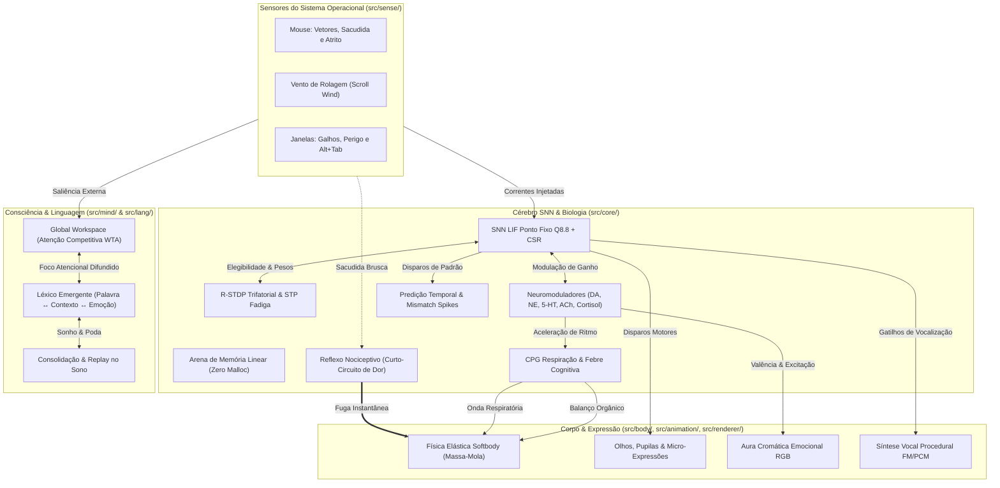
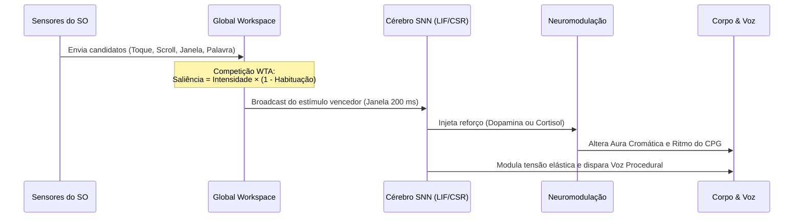

# 🐾 Caddin (v1.1.3)
### Mascote Virtual Autônomo com SNN em Ponto Fixo Q8.8, Consciência Funcional e Física Softbody

O **Caddin** é um companheiro virtual vivo para desktop que opera como uma **simulação neurobiológica ativa (Tabula Rasa)** em tempo real. Ao contrário de scripts rígidos ou invocações pesadas de LLM, o Caddin possui um cérebro baseado em **Rede Neural Pulsada (Spiking Neural Network - SNN)** com conectividade CSR esparsa, plasticidade R-STDP trifatorial, homeostase hormonal, gerador central de ritmo respiratório (CPG), espaço de trabalho global atencional (Global Workspace), percepção física contínua do sistema operacional e sintetizador de voz procedural sem dependências externas.

Com um **motor 2D ultraleve** com física procedural de corpo mole (*softbody*), janela translúcida flutuante e **consumo de memória ultrabaixo (~7 MB de RAM total)**, roda 100% nativo tanto no **Linux (X11)** quanto no **Windows (Win32 GDI)** sem depender de OpenGL, Mesa, LLVM ou bibliotecas pesadas.

---

## 📑 Sumário
1. [Destaques da Versão 1.1.3](#-destaques-da-versão-113)
2. [Diagramas de Arquitetura](#-diagramas-de-arquitetura)
   - [Diagrama de Blocos Modular](#diagrama-de-blocos-modular)
   - [Fluxo de Consciência Funcional e Atenção](#fluxo-de-consciência-funcional-e-atenção)
3. [Arquitetura Detalhada dos Módulos](#-arquitetura-detalhada-dos-módulos)
   - [1. Núcleo Matemático e SNN (`src/core/`)](#1-núcleo-matemático-e-snn-srccore)
   - [2. Biologia, CPG e Neuromodulação (`src/core/`)](#2-biologia-cpg-e-neuromodulação-srccore)
   - [3. Sensores Físicos do Desktop (`src/sense/`)](#3-sensores-físicos-do-desktop-srcsense)
   - [4. Expressão Corporal e Voz Procedural (`src/body/`)](#4-expressão-corporal-e-voz-procedural-srcbody)
   - [5. Espaço de Trabalho Global e Mente (`src/mind/`)](#5-espaço-de-trabalho-global-e-mente-srcmind)
   - [6. Linguagem Emergente e Associação (`src/lang/`)](#6-linguagem-emergente-e-associação-srclang)
   - [7. Física Softbody e Renderizador CPU (`src/animation/`, `src/renderer/`)](#7-física-softbody-e-renderizador-cpu)
   - [8. Camadas de Plataforma (`src/platform/`)](#8-camadas-de-plataforma-srcplatform)
4. [Instalação e Compilação](#-instalação-e-compilação)
   - [Linux (Nativo X11)](#linux-nativo-x11)
   - [Windows (Compilação Cruzada via MinGW-w64)](#windows-compilação-cruzada-via-mingw-w64)
   - [Execução da Suíte de Testes Automatizada (`make test`)](#execução-da-suíte-de-testes-automatizada-make-test)
5. [Controles e Dinâmica Física](#-controles-e-dinâmica-física)
6. [Persistência Sináptica e Sono](#-persistência-sináptica-e-sono)

---

## 🌟 Destaques da Versão 1.1.3

- **SNN LIF em Ponto Fixo Q8.8 & CSR Esparso (`src/core/snn.c`):** Substituição de matrizes densas por formato CSR (Compressed Sparse Row) com anel de atraso sináptico de 8 slots e suporte a milhares de neurônios gastando menos de 1 MB de RAM (2570+ ticks/s em 1 CPU core).
- **Plasticidade Trifatorial R-STDP + Fadiga Sináptica STP:** O aprendizado sináptico é modulado por dopamina com decaimento de traços de elegibilidade e modelo biofísico de Tsodyks-Markram (depressão por esgotamento de neurotransmissores e reposição passiva).
- **Banho Hormonal Pentafatorial (`src/core/neuromod.c`):** Concentrações contínuas de Dopamina (DA), Noradrenalina (NE), Serotonina (5-HT), Acetilcolina (ACh) e Cortisol modulando limiares e ganhos sensoriais.
- **Arco Reflexo Nociceptivo Espinhal:** Sacudidas ou acelerações violentas bypassam o córtex associativo e acionam diretamente contrações musculares espasmódicas de fuga e pânico em 0 ticks.
- **CPG (Central Pattern Generator) de Respiração e Febre Cognitiva (`src/core/cpg.c`):** Oscilador marcapasso intrínseco para respiração e batimento cardíaco com expansão física visível do corpo, acompanhado de proteção anti-saturação neural (apagão protetor temporário se a rede sobreaquecer).
- **Codificação Preditiva Temporal (`src/core/predict.c`):** Aprendizado de cadência entre estímulos e emissão espontânea de *Mismatch Spikes* (surpresa e alerta) quando um evento esperado não ocorre.
- **Sensores do Desktop (`src/sense/`):**
  - Vetores de velocidade, aceleração de sacudida e atrito físico do cursor com o corpo mole.
  - Vento de rolagem (*scroll wind*): corrente de ar gerada pela roda do mouse com decaimento exponencial.
  - Janelas como galhos de apoio (*perching*), detecção de troca de foco (`Alt+Tab`) e quina superior direita (botão fechar) como área de risco/fobia.
- **Voz Procedural PCM/FM (`src/body/voice_synth.c`):** Síntese em tempo real (16 kHz mono) sem arquivos de áudio externos, gerando ronronados graves, gorjeios ascendentes de pergunta (`?`), alarmes de susto e balbucio de formantes vocais.
- **Espaço de Trabalho Global (Global Workspace) e Atenção WTA (`src/mind/workspace.c`):** Competição estocástica por saliência entre múltiplos estímulos externos e necessidades internas com habituação adaptativa.
- **Léxico Emergente e Consolidação no Sono (`src/lang/lexicon.c`):** Associação multimodal de palavras/sons com situações e estados emocionais afetivos, curiosidade dirigida em ambiguidades e poda de ruídos durante o sono.
- **Zero Alocação no Laço Principal:** Gestão estrita de memória através de arenas lineares alinhadas (`src/core/arena.c`).

---

## 📊 Diagramas de Arquitetura

### Diagrama de Blocos Modular



### Fluxo de Consciência Funcional e Atenção



---

## 🧠 Arquitetura Detalhada dos Módulos

```text
caddin/
├── CMakeLists.txt / Makefile
├── include/pet/               # Headers de exportação pública
├── src/
│   ├── core/                  # Núcleo neural puro (independente de SO e GUI)
│   │   ├── arena.c / .h       # Arenas de alocação estática linear
│   │   ├── rng.c / .h         # Gerador pseudoaleatório determinístico xoshiro128**
│   │   ├── fixed.h            # Aritmética de ponto fixo Q8.8 e macros de saturação
│   │   ├── snn.c / .h         # SNN LIF em ponto fixo, formato CSR e anel de atraso
│   │   ├── neuromod.c / .h    # Difusão de neuromoduladores e reflexo nociceptivo
│   │   ├── cpg.c / .h         # Central Pattern Generator (respiração e febre cognitiva)
│   │   └── predict.c / .h     # Codificação preditiva temporal e mismatch spikes
│   ├── sense/                 # Tradutores físicos do ambiente desktop
│   │   ├── sense_mouse.c / .h # Vetores, aceleração, atrito e sacudida do mouse
│   │   ├── sense_scroll.c / .h# Vento de rolagem e decaimento aerodinâmico
│   │   └── sense_windows.c/.h # Topologia de janelas, galhos de pouso e quina de perigo
│   ├── body/                  # Expressividade e bioacústica
│   │   ├── palette.c / .h     # Mapeamento do vetor neuroquímico em aura cromática RGB
│   │   └── voice_synth.c / .h # Síntese FM/PCM procedural em tempo real
│   ├── mind/                  # Consciência funcional e atenção
│   │   └── workspace.c / .h   # Espaço de Trabalho Global (competição WTA e habituação)
│   ├── lang/                  # Aquisição de linguagem do zero
│   │   └── lexicon.c / .h     # Léxico multimodal e consolidação durante o sono
│   ├── animation/             # Física elástica (massa-mola) e interpolação de poses
│   ├── renderer/              # Rasterizador 2D por software em CPU (sem OpenGL)
│   ├── platform/              # Backends de janela (X11 XShm e Win32 GDI)
│   └── main.c                 # Laço principal de alta resolução
├── tests/                     # Suíte de testes unitários headless
└── bin/                       # Executáveis pré-compilados Linux e Windows
```

---

## 🛠️ Instalação e Compilação

### Dependências
- **Linux:** `gcc`, `make`, `cmake`, `libx11-dev`, `libxext-dev`.
- **Windows (Compilação Cruzada):** `x86_64-w64-mingw32-gcc`, `ninja-build`.

---

### Linux (Nativo X11)

#### Compilação Rápida:
```bash
make
```

#### Executar o Mascote:
```bash
make run
# ou diretamente:
./build/caddin
```

---

### Windows (Compilação Cruzada via MinGW-w64)

Para compilar o binário estático `.exe` de 64 bits para Windows a partir do Linux:
```bash
make windows
```
O executável independente estará disponível em `build-windows/caddin.exe` e `bin/caddin.exe`.

---

### Execução da Suíte de Testes Automatizada (`make test`)

O projeto inclui uma suíte completa de testes unitários headless (executáveis mesmo sem monitor ou display):

```bash
make test
```

Saída da verificação de integridade:
```text
Test project /home/carlos/Antigravity/caddin/build
    Start 1: CoreTest
1/6 Test #1: CoreTest .........................   Passed    0.00 sec
    Start 2: SnnTest
2/6 Test #2: SnnTest ..........................   Passed    0.32 sec
    Start 3: BiologyTest
3/6 Test #3: BiologyTest ......................   Passed    0.00 sec
    Start 4: SensorsTest
4/6 Test #4: SensorsTest ......................   Passed    0.00 sec
    Start 5: BodyTest
5/6 Test #5: BodyTest .........................   Passed    0.00 sec
    Start 6: MindLangTest
6/6 Test #6: MindLangTest .....................   Passed    0.00 sec

100% tests passed, 0 tests failed out of 6 (Total: 0.36 sec)
```

---

## 🎮 Controles e Dinâmica Física

| Ação do Usuário | Resposta Biológica Emergente |
|---|---|
| **Passar o cursor suavemente sobre o pet** | Atrito suave (`sense_mouse_is_rubbing`), liberação de Dopamina/Serotonina, ronronar procedural (`VOICE_PURR`). |
| **Sacudir o pet rapidamente** | Aceleração violenta aciona o **Arco Reflexo Nociceptivo**, sobressalto com alarme sonoro (`VOICE_ALARM`) e pico de Noradrenalina/Cortisol. |
| **Rolar a roda do mouse perto do pet** | Gera vento de rolagem (`sense_scroll_get_wind`), fazendo o pet recuar ou fechar os olhos contra a lufada de ar. |
| **Arrastar e arremessar no ar** | Física balística inercial com gravidade, desaceleração aerodinâmica e amortecimento elástico no solo. |
| **Aproximar do botão fechar (X vermelho)** | Sensor de quina perigosa ativa aversão e tentativa ativa de esquiva do cursor. |
| **Trocar de janela (`Alt+Tab`)** | Sobressalto atencional breve no Global Workspace com reorientação do olhar. |
| **Inatividade prolongada** | A frequência respiratória do CPG desacelera, as pupilas dilatam e o pet adormece, iniciando o replay sináptico de consolidação. |

---

## 💾 Persistência Sináptica e Sono

O Caddin preserva todo o aprendizado biológico entre sessões:
- A cada 60 segundos ou ao fechar o aplicativo, os pesos plásticos e os estados hormonais são gravados em disco (`caddin.brain`).
- Durante o sono, a rotina `lexicon_consolidate_sleep` remove automaticamente ruídos e consolida memórias associativas mais frequentes e salientes.
- O formato utiliza escrita segura para prevenir qualquer corrupção de estado.
