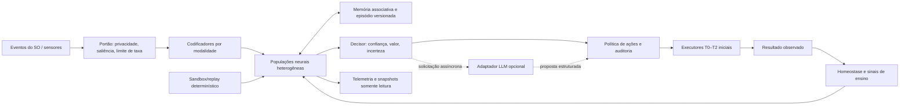

# Carmin — Arquitetura-alvo e decisões pendentes

**Estado:** proposta em validação; baseline inicial disponível em um host, contratos ainda não congelados.
**Atualizado:** 2026-11-22

## 1. Definição operacional do alvo

O alvo “1 milhão de neurônios” será considerado funcional quando a arquitetura mantiver 1.048.576 unidades indexáveis e com dinâmica definida, cada uma com estado recuperável e participação em populações/projeções, e demonstrar por experimentos que estímulos e aprendizado alteram saídas de forma repetível. Um contador ou reserva de memória sem participação na computação não atende ao objetivo.

O plano deve distinguir quatro custos: estado por unidade, conectividade/estado sináptico, custo de atualização por tick e custo por evento. Não é necessário atualizar todas as unidades a 1 kHz: populações terão fidelidade e relógio próprios, com conectividade procedural apenas onde a topologia for fixa e regenerável.

## 2. Princípios propostos

1. **Construir sobre o C11 existente:** preservar arena, SNN, codificadores, SDM, persistência e sensores quando a inspeção confirmar sua função e qualidade.
2. **Estado compacto (SoA):** armazenar estado em vetores tipados, alinhados quando medição comprovar benefício. Evitar um objeto/worker independente por unidade.
3. **Atividade esparsa:** listas/bitsets de unidades ativas, filas de spikes e propagação apenas pelas projeções tocadas; manter atualizações densas somente onde necessárias e medidas.
4. **Populações heterogêneas:** LIF onde temporização importa; expansão esparsa/k-WTA ou projeções procedurais para populações associativas grandes; estado escalar compartilhado para homeostase lenta.
5. **Memória explícita por função:** SNN para associação/valor e dinâmica temporal; estruturas comuns versionadas para fatos e episódios. Não presumir que uma SDM finita substitui banco episódico ilimitado.
6. **Eventos como fronteira:** normalizar entradas do SO em eventos tipados; tratar sensores ausentes como condição suportada. Filtro de privacidade antes de codificação ou persistência.
7. **Ações governadas por política:** rede, agente e LLM podem propor; componente determinístico valida tipo, alvo, permissão, taxa e confirmação.
8. **Aprendizado com rollback:** toda alteração persistente é versionada, validada em replay/sandbox e recuperável.
9. **Medição antes de SIMD/processos:** primeiro baseline, perfil e gargalo; depois otimização escalar equivalente, SIMD opcional e concorrência se reduzirem custo observado.

## 2.1 Perfil ativo configurado

O runtime usado por `src/main.c` configura 1.048.576 unidades nos 120 grupos existentes, multiplicador 512 sobre os perfis-base. A montagem gera conectividade CSR limitada a 64 saídas por unidade e sem matriz `N×NL`. A distribuição e os parâmetros dos grupos estão em [Inventário dos grupos](INVENTARIO_GRUPOS.md). O caminho legado de carregamento mantém apenas pesos que coincidem com projeções da topologia ativa.

Essa configuração dá estado individual a todas as unidades; por si só, não comprova utilidade comportamental. O passo LIF foi alterado para integrar alvos que receberam eventos e avançar células silenciosas de forma lazy. Uma referência densa e cenários reproduzíveis estão em [`BASELINE.md`](BASELINE.md): carga média mede 3,15 ms para `brain_step(16 ms)`, e carga alta 18,92 ms neste host. Isso não comprova tempo real geral; equivalência numérica extensa, aprendizado no loop completo e segunda máquina seguem em aberto.

Os dois grupos funcionais novos ocupam os antigos slots genéricos `PLASTIC_NODE1/2` para manter IDs e formato de estado ontogenético estáveis. Grupos `exc/inh` são metadados; conexões inibitórias continuam representadas pelo sinal explícito dos pesos. Essa convenção ainda precisa de decisão se Dale for adotada como regra rígida.

## 3. Diagrama lógico inicial

## 4. Escala e estimativas

Os anexos oferecem estimativas úteis para formular cenários, mas não são medições do Carmin. A rede ativa configura 1.048.576 unidades e fan-out máximo de 64; a contagem resultante depende das regras de cada grupo e deve ser obtida em execução. O máximo teórico pelo limite é 67.108.864 sinapses. CSR com destino de 32 bits, peso de 32 bits e base de 8 bits exigiria até ~603 MB decimais para as colunas, antes de offsets, estado neural, alinhamento e buffers. O builder reserva até essa capacidade e reduz os vetores ao número de conexões produzidas.

Usando o cálculo ilustrativo de 1.048.576 unidades e 64 sinapses médias por unidade:

- 67.108.864 sinapses.
- CSR com destino de 32 bits + peso de 8 bits + atraso/flags de 8 bits requer ~402,7 MB decimais (~384 MiB) apenas para essas colunas, antes de alinhamento, offsets, índices auxiliares e estados de plasticidade.
- A proposta de estado mínimo de 8 bytes por unidade corresponde a 8 MiB. O SNN atual tem mais campos: `v`, `thr`, `i_in`, refratário, região, spike, traços e fila; portanto seu layout atual não cabe nesse cálculo simplificado.
- A SDM descrita no blueprint (65.536 × (256 B de endereço + 2.048 B de contadores)) ocupa ~151 MB decimais (~144 MiB), sem metadados e alinhamentos. A implementação presente declara 128 localizações.
- Um buffer denso de atraso `D × N × sizeof(fix16_t)` cresce rapidamente. Para `D=8`, `N=1.048.576` isso representa 16 MiB. Deve comparar-se com filas de entrega esparsas.

Há uma baseline inicial de CPU temporal e RSS do processo nesta máquina em [`BASELINE.md`](BASELINE.md), mas não é representativa de todos os dispositivos. A carga alta foi medida acima do período de 16 ms, e o passo de aprendizado deve ser contado junto ao runtime. Os orçamentos só passam a ser compromissos após benchmarks em hardware-alvo adicional, com perfil de atividade, densidade e carga de aprendizado publicados.

## 5. Tecnologia de referência, não dependência inicial

| Tecnologia | Uso que pode informar | Limite/decisão atual |
|---|---|---|
| NEST | Referência para simulação de redes de neurônios pontuais em grande escala e medição. | Não incorporar ao runtime C11; avaliar como referência de modelos e, se útil, ferramenta externa de validação. GPL-2.0-or-later exige análise de distribuição antes de qualquer incorporação. |
| Brian2 | Prototipagem e comparação de regras SNN; modo standalone gera C++ para execução independente. | Bom candidato a instrumento de pesquisa, não dependência embarcada. Compatibilidade de regras e resultados precisa ser provada. |
| Lava | Referência para aplicações neuroinspiradas e mapeamento para hardware neuromórfico. | Avaliar apenas se houver hardware/experimento concreto; dependência e ecossistema Python não justificam adoção automática. |
| llama.cpp `llama-server` | Backend opcional assíncrono e local com endpoints compatíveis com OpenAI. | Processo externo, timeout e saída estruturada; não executar no laço neural nem confiar na saída sem política. |
| PettingZoo | API/ambiente de referência para benchmarks multiagentes. | Útil em harness externo para simulação; não requer colocar Python no aplicativo C. |
| Ray | Orquestração de experimentos distribuídos via tasks/actors. | Peso operacional alto para o produto desktop; considerar em experimentos de laboratório apenas se carga paralela justificar. |

Detalhes e fontes primárias estão em [Referências técnicas](REFERENCIAS.md).

## 6. Decisões em aberto antes de congelar interfaces

- Qual alvo de plataformas é obrigatório para o runtime Carmin e em que ordem? O CMake atual inclui Linux/X11, Windows, Android e headless.
- Quais módulos de rede legados são efetivamente executados e como persistem estado? Há `neuro.*` na raiz e `src/core/snn.*` no mesmo build.
- Quais dados de sensores podem ser capturados por padrão? Reavaliar permissões e `.caddinrc` antes de novos canais ou memória.
- Os 64 grupos/8 macro-regiões do blueprint têm evidência funcional para o produto? Não congelar IDs até mapear tarefas, entradas e saídas mensuráveis.
- Qual população deve ser event-driven e qual precisa de clock? Validar equivalência sob os modelos de corrente, atraso e atividade sustentada realmente escolhidos.
- Tipos de ponto fixo propostos no blueprint têm faixa suficiente? Fazer análise de saturação, overflow, custo SIMD e determinismo entre arquiteturas.
- Como armazenar checkpoints com migração, CRC, compatibilidade e gravação atômica sem interromper o runtime?
- Quais limites de CPU/RAM/latência para cada perfil de dispositivo? Medir e documentar baseline primeiro.
- Qual licença e política de distribuição para qualquer dependência ou conteúdo de modelo externo?

## 7. Segurança e autonomia

Começar com observação e sugestões (T0–T2). A execução autônoma restrita é fase futura e só pode ser habilitada por allowlist explícita, reversibilidade, diário de auditoria, limite de taxa e kill-switch. Texto, OCR e resultados externos são dados não confiáveis; não podem alterar permissões nem instruir o executor diretamente. O LLM não é autoridade de política.
