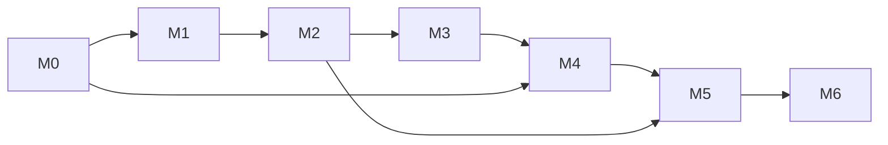

# Carmin — Plano de implementação M0–M6

**Estado:** ordem preliminar baseada na inspeção inicial.
**Atualizado:** 2026-11-22

Este plano não declara tarefas concluídas por existirem módulos com nomes parecidos. Cada etapa começa por localizar o caminho ativo, escrever uma hipótese testável e definir métricas antes da mudança de runtime.

**Progresso:** M0 foi iniciado; M2 configurou 1.048.576 unidades e constrói CSR diretamente com fan-out limitado. A atualização densa, a qualidade comportamental e o custo de execução ainda precisam de medição. Nenhuma etapa está marcada como completa antes de regressões e medições.

## M0 — Inventário executável e linha de base

**Objetivo:** entender o sistema que de fato roda e estabelecer referências comparáveis.

- Rastrear em `src/main.c` inicialização, atualização, sensores, rede neural e persistência até às funções concretas.
- Mapear o uso da API `neuro.*` em raiz contra `src/core/snn.*`, e confirmar quais dados alimentam cada uma.
- Registrar configuração ativa, tamanhos de arena/SDM, arquivos persistidos e capacidades por plataforma.
- Medir RSS, memória da arena, CPU ociosa/ativa, taxa de ticks, spikes, sinapses processadas e latência de decisão com cenários fixos.
- Criar harness reproduzível de seed/replay headless sem alterar regras do sistema.

**Pronto quando:** mapa de fluxo revisável, comandos de medição documentados e baseline reproduzível publicado em `docs/carmin/BASELINE.md`.

## M1 — Contratos mínimos e integridade

**Objetivo:** estabelecer fronteiras de eventos, estado, resultado e snapshots a partir do fluxo real do M0.

- Especificar versão, timestamp, canal, valor, proveniência, flags de privacidade e condição de sensor indisponível.
- Escolher produtor/consumidor e propriedade de fila; só usar SPSC/MPSC quando o número real de escritores justificar.
- Definir como snapshots são lidos sem corrida e como replay registra seeds e versões de codificador.
- Preservar compatibilidade de arquivos existentes; preparar migração testável antes de gravar novo formato por padrão.

**Pronto quando:** contratos exercitados em teste headless e replay de eventos produzir a mesma sequência de decisões/métricas dentro da tolerância definida.

## M2 — Núcleo compacto escalável

**Objetivo:** prototipar o primeiro aumento de capacidade mantendo API de integração e comportamento observável.

- Medir custo por estado e por sinapse no layout atual; corrigir/registrar limites de capacidade e construção CSR antes de ampliar a topologia.
- Separar projeções plásticas das fixas. Avaliar armazenamento CSR compacto para plásticas e geração procedural determinística para fixas.
- Implementar perfil/população mínima compacta em uma branch experimental configurável; preservar o caminho atual como referência até equivalência ou ganho provado.
- Medir 2k, 10k, 100k e degraus maiores em atividade baixa/média/alta; contar operações e bytes, além de ticks por segundo.
- Comparar atualização densa e event-driven sob premissas idênticas; declarar latência de despertar e erro numérico.

**Pronto quando:** limites RAM/CPU medidos, comportamento reproduzível e curva de escala validada em pelo menos duas configurações de hardware; nenhuma extrapolação de 1M baseada apenas em contador.

## M3 — Memória e aprendizado mensuráveis

**Objetivo:** ligar contexto, associação e resultado, medindo aprendizagem e esquecimento.

- Validar SDM existente (128 localizações) e seus limites/custos antes de dimensionar alternativa.
- Separar memória factual, episódica e associação de valor; versionar esquema de features.
- Implementar um benchmark controlado: associação sintética contexto→resultado, ruído, generalização próxima, esquecimento e replay.
- Medir sucesso, falso positivo, tempo de resposta e custo de memória; comparar com regra baseline sem aprendizado.
- Só então testar STDP de três fatores, k-WTA/expansão procedural ou homeostase como mudanças incrementais.

**Pronto quando:** ganho replicável contra baseline e estabilidade nos cenários de saturação, ausência de recompensa e reversão de associação.

## M4 — Política, ações e ponte assíncrona

**Objetivo:** completar o ciclo fechado sem bloquear o runtime.

- Começar por T0–T2: observação autorizada, saída expressiva e proposta com confirmação.
- Especificar catálogo tipado de ações e validador determinístico independente da rede.
- Implementar filas com timeout, cancelamento, limite de tamanho e tratamento de indisponibilidade.
- Avaliar LLM local/remoto opcional via adaptador, com payload mínimo, saída estruturada, limites de contexto e nenhuma autoridade executiva.
- Registar resultado explícito (aceito, recusado, cancelado, falhou) para sinal de aprendizado.

**Pronto quando:** teste de estresse comprova que latência do núcleo permanece limitada durante timeout/queda do backend e nenhuma proposta inválida atravessa a política.

## M5 — Simulação, consolidação e telemetria

**Objetivo:** validar adaptação fora da sessão real e dar observabilidade suficiente para evolução segura.

- Construir cenários headless por relógio virtual: ritmo, ociosidade, troca de contexto, erro/sucesso e sensor ausente.
- Adicionar comparações entre estratégias com seeds fixas; definir métricas de generalização e eficiência.
- Implementar replay/consolidação apenas após M3 demonstrar benefício mensurável e após versionamento/persistência validarem rollback.
- Expor snapshots read-only de taxa por região, atividade, pesos, confiança, decisão e motivo resumido.

**Pronto quando:** relatório demonstra diferença estatística/prática entre estratégia nova e baseline e um checkpoint inválido pode ser rejeitado sem perda do anterior.

## M6 — Escala-alvo, otimização e evolução controlada

**Objetivo:** avançar degrau a degrau até o alvo funcional e medir custo real.

- Escalar por checkpoints de capacidade; testar recuperação, determinismo, RAM, CPU, armazenamento e latência em hardware registrado.
- Perfil de baixo consumo pode reduzir densidade ativa/conectividade sem fingir neurônios ausentes: todos os IDs e dinâmica definida continuam cobertos por teste funcional.
- SIMD (AVX2/NEON) só após benchmark de kernel; validar fallback escalar e equivalência numérica por arquitetura.
- Mutação estrutural permanece em sandbox, versionada, validada e com rollback.
- Revisar integração de renderização ampliada somente depois de estabilizar a telemetria e o orçamento do núcleo.

**Pronto quando:** os critérios de capacidade, utilidade funcional, generalização, eficiência e estabilidade forem atendidos na escala divulgada; relatórios não podem substituir os resultados brutos reproduzíveis.

## Dependências

Partes de interface/política podem ser prototipadas em paralelo após M0 quando não alterarem contratos do núcleo. Ampliação de neurônios, mudança de feature schema, plasticidade e persistência dependem das medições e contratos anteriores.

## Revisão do blueprint fornecido

O blueprint de 1.048.576 unidades é uma fonte de hipóteses detalhadas (SoA, CSR, perfis celulares, regiões, eventos, aprendizado, simulação e runtime assíncrono). A configuração atual chegou a 1.048.576 unidades e usa montagem CSR limitada por fan-out; desempenho real ainda não foi medido. Contratos numéricos e topologia fechados do blueprint ficam pendentes de evidência.
