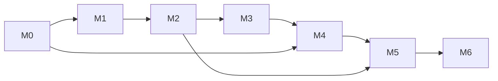

# Carmin — Plano de implementação M0–M6

**Estado:** M0 parcial; M1 parcial; M2 parcial; M3 iniciado com SDM versionada e benchmark controlado.
**Atualizado:** 2026-11-22

Este plano não declara tarefas concluídas por existirem módulos com nomes parecidos. Cada etapa começa por localizar o caminho ativo, escrever uma hipótese testável e definir métricas antes da mudança de runtime.

**Progresso do plano anterior:** M0 tem o caminho ativo, inventário numérico e baseline 2k/10k/100k/1M em três cargas documentados num host; falta instrumentação do app inteiro e inventário completo de produtores/consumidores. M1 tem evento tipado integrado, snapshot local com fingerprint de população/grupos e testes, mas falta replay real e incluir/validar fingerprint no checkpoint cerebral. M2 tem curva, STDP, hashes completos coincidentes em séries fixas e amostragem comparada em 30 seeds; falta segundo hardware, carga sustentada e validação comportamental. M0–M2 seguem **parciais**. M3 tem SDM2 e índice episódico limitado persistidos, benchmark e simulação temporal; falta ingestão do loop cotidiano, campanha multiseed, generalização e critérios robustos de saturação. M4 tem Guard, fila limitada, resultados e testes em biblioteca, mas faltam UI, worker, executor e ensaio de latência externa. M5 tem simulação sintética e snapshot local descartado; falta replay real, exportação de telemetria e rollback multiarquivo. M6 ainda depende de segunda arquitetura/hardware e utilidade funcional. Nenhuma etapa está completa.

**Plano novo em acompanhamento:** ver [`PLANO_EVENTOS_E_DESKTOP.md`](PLANO_EVENTOS_E_DESKTOP.md), derivado do plano fornecido nesta conversa. O kernel event-driven, contrato síncrono e biblioteca Guard estão implementados em escopo limitado; faltam hardware adicional, carga extrema, integração de política/executor e reorganização funcional validada dos pools.

## M0 — Inventário executável e linha de base

**Objetivo:** entender o sistema que de fato roda e estabelecer referências comparáveis.

- Rastrear em `src/main.c` inicialização, atualização, sensores, rede neural e persistência até às funções concretas.
- Mapear o uso da API `neuro.*` em raiz contra `src/core/snn.*`, e confirmar quais dados alimentam cada uma.
- Registrar configuração ativa, tamanhos de arena/SDM, arquivos persistidos e capacidades por plataforma.
- Medir RSS, memória da arena, CPU ociosa/ativa, taxa de ticks, spikes, sinapses processadas e latência de decisão com cenários fixos.
- Criar harness reproduzível de seed/replay headless sem alterar regras do sistema.

**Pronto quando:** mapa de fluxo revisável, comandos de medição documentados e baseline reproduzível publicado em `docs/carmin/BASELINE.md`.

## M1 — Contratos mínimos e integridade

**Objetivo:** estabelecer fronteiras de eventos, estado, resultado e snapshots a partir do fluxo real do M0.

- Especificar versão, timestamp, canal, valor, proveniência, flags de privacidade e condição de sensor indisponível.
- Escolher produtor/consumidor e propriedade de fila; só usar SPSC/MPSC quando o número real de escritores justificar.
- Definir como snapshots são lidos sem corrida e como replay registra seeds e versões de codificador.
- Preservar compatibilidade de arquivos existentes; preparar migração testável antes de gravar novo formato por padrão.

**Pronto quando:** contratos exercitados em teste headless e replay de eventos produzir a mesma sequência de decisões/métricas dentro da tolerância definida.

**Situação atual:** parcial. `CarminEvent` v1 tipa versão/tamanho, timestamp, sequência, canal, origem, flags e valor; o lote está ligado ao caminho real em `src/main.c` e o teste headless cobre validação/frescor/privacidade. O fluxo síncrono não precisa de fila concorrente. Replay sintético existe no benchmark; replay de eventos reais e versão/hash do mapa de grupos dentro de snapshots ainda faltam.

## M2 — Núcleo compacto escalável

**Objetivo:** prototipar o primeiro aumento de capacidade mantendo API de integração e comportamento observável.

- Medir custo por estado e por sinapse no layout atual; corrigir/registrar limites de capacidade e construção CSR antes de ampliar a topologia.
- Separar projeções plásticas das fixas. Avaliar armazenamento CSR compacto para plásticas e geração procedural determinística para fixas.
- Implementar perfil/população mínima compacta em uma branch experimental configurável; preservar o caminho atual como referência até equivalência ou ganho provado.
- Medir 2k, 10k, 100k e degraus maiores em atividade baixa/média/alta; contar operações e bytes, além de ticks por segundo.
- Comparar atualização densa e event-driven sob premissas idênticas; declarar latência de despertar e erro numérico.

**Pronto quando:** limites RAM/CPU medidos, comportamento reproduzível e curva de escala validada em pelo menos duas configurações de hardware; nenhuma extrapolação de 1M baseada apenas em contador. **Situação atual:** parcial; há comparação por eventos/densa em 2k/10k/100k/1M e baixa/média/alta atividade num host, documentada em [`CURVA_ESCALA.md`](CURVA_ESCALA.md). A carga alta excede 16 ms, faltam segundo hardware e validação comportamental.

## M3 — Memória e aprendizado mensuráveis

**Objetivo:** ligar contexto, associação e resultado, medindo aprendizagem e esquecimento.

- Validar SDM existente (128 localizações) e seus limites/custos antes de dimensionar alternativa.
- Separar memória factual, episódica e associação de valor; versionar esquema de features.
- Implementar um benchmark controlado: associação sintética contexto→resultado, ruído, generalização próxima, esquecimento e replay.
- Medir sucesso, falso positivo, tempo de resposta e custo de memória; comparar com regra baseline sem aprendizado.
- Só então testar STDP de três fatores, k-WTA/expansão procedural ou homeostase como mudanças incrementais.

**Progresso:** SDM2 carrega schema, geometria, endereços, contadores, total de escritas e CRC32, recusando truncamento, bytes extras, versão incompatível e checksum errado sem mutar a memória. SDM1 é reconhecido como legado, mas o app reinicializa a SDM porque endereços ausentes impedem recuperar associações corretamente. `bench/bench_sdm_association.c` mede consultas exatas, ruído, replay, sono, interferência e latência contra baseline; primeira coleta: 100% exato, 97,85% com 6,25% ruído, 4,2% no palpite fixo e 100% após sono, numa seed/24 pares. `SdmEpisodeIndex` experimental, até 256 episódios, tem store/replay exatos, substituição de resultado, consolidação e persistência schema/CRC; o app carrega e salva `caddin.episodes`, mas ainda não grava episódios do uso cotidiano. Harness temporal teve 695/720 acertos (96,53%) numa seed. São resultados sintéticos estreitos; faltam multiseed, generalização, saturação e integração cotidiana. M3 segue incompleto.

**Simulação temporal:** `simulate_association` executa 720 frames de relógio virtual, 24 contextos, reversão no frame 360 e consolidação após cada bloco. O episódio é separado do recall distribuído para medir corretamente rótulo exato; uma coleta com seed 42 gerou 695/720 acertos (96,53%), 24 stale, 1 vazio e hash `67aa7c1001b4ae12`. Esse resultado é de uma seed e de índice exato, não demonstra generalização da SDM. Protocolo em [`SIMULACAO.md`](SIMULACAO.md).

**Validação da árvore atual:** suíte headless Linux completa 17/17 passou em Release. Cross-build Windows produziu `caddin.exe` e `caddin_monitor.exe`; execução dos testes Windows não está disponível neste host sem Wine ou Windows.

**Release desta atualização:** commit `492c1d9`, tag `v1.6.0`, pacotes Linux/Windows e notas publicados em [Carmin v1.6.0](https://github.com/HololiveStudios/caddin/releases/tag/v1.6.0). Esta publicação não implica conclusão de M0–M6.

**Pronto quando:** ganho replicável contra baseline e estabilidade nos cenários de saturação, ausência de recompensa e reversão de associação.

## M4 — Política, ações e ponte assíncrona

**Objetivo:** completar o ciclo fechado sem bloquear o runtime.

- Começar por T0–T2: observação autorizada, saída expressiva e proposta com confirmação.
- Especificar catálogo tipado de ações e validador determinístico independente da rede.
- Implementar filas com timeout, cancelamento, limite de tamanho e tratamento de indisponibilidade.
- Avaliar LLM local/remoto opcional via adaptador, com payload mínimo, saída estruturada, limites de contexto e nenhuma autoridade executiva.
- Registar resultado explícito (aceito, recusado, cancelado, falhou) para sinal de aprendizado.

**Pronto quando:** teste de estresse comprova que latência do núcleo permanece limitada durante timeout/queda do backend e nenhuma proposta inválida atravessa a política.

**Progresso:** `ActuatorGuard` v1 e `CarminAsyncQueue` estão na biblioteca e testes focados cobrem limite de capacidade, tamanho, cancelamento, timeout, conclusão única, confirmação, allowlist e privacidade. Nenhum worker, UI ou executor real está integrado, logo não há teste de carga concorrente ou LLM; M4 continua parcial. `CarminTelemetrySnapshot` v1 captura localmente 120 taxas e um hash de versão/mapa dos grupos em 1Hz, mas ainda não publica nem persiste a estrutura; veja [`CONTRATO_EVENTOS.md`](CONTRATO_EVENTOS.md).

## M5 — Simulação, consolidação e telemetria

**Objetivo:** validar adaptação fora da sessão real e dar observabilidade suficiente para evolução segura.

- Construir cenários headless por relógio virtual: ritmo, ociosidade, troca de contexto, erro/sucesso e sensor ausente.
- Adicionar comparações entre estratégias com seeds fixas; definir métricas de generalização e eficiência.
- Implementar replay/consolidação apenas após M3 demonstrar benefício mensurável e após versionamento/persistência validarem rollback.
- Expor snapshots read-only de taxa por região, atividade, pesos, confiança, decisão e motivo resumido.

**Pronto quando:** relatório demonstra diferença estatística/prática entre estratégia nova e baseline e um checkpoint inválido pode ser rejeitado sem perda do anterior.

**Progresso:** existem harnesses sintéticos reproduzíveis de SDM e associação temporal em [`SDM_BENCHMARK.md`](SDM_BENCHMARK.md) e [`SIMULACAO.md`](SIMULACAO.md). `CarminTelemetrySnapshot` v1 captura contadores read-only e taxas dos 120 pools com fingerprint de população/grupos no loop a 1Hz. A estrutura é descartada localmente, ainda sem buffer público concorrente ou UI; replay de eventos de SO e publicação de snapshot continuam pendentes. Não há teste de persistência com falha de energia/rollback A/B. M5 parcial.

## M6 — Escala-alvo, otimização e evolução controlada

**Objetivo:** avançar degrau a degrau até o alvo funcional e medir custo real.

- Escalar por checkpoints de capacidade; testar recuperação, determinismo, RAM, CPU, armazenamento e latência em hardware registrado.
- Perfil de baixo consumo pode reduzir densidade ativa/conectividade sem fingir neurônios ausentes: todos os IDs e dinâmica definida continuam cobertos por teste funcional.
- SIMD (AVX2/NEON) só após benchmark de kernel; validar fallback escalar e equivalência numérica por arquitetura.
- Mutação estrutural permanece em sandbox, versionada, validada e com rollback.
- Revisar integração de renderização ampliada somente depois de estabilizar a telemetria e o orçamento do núcleo.

**Pronto quando:** os critérios de capacidade, utilidade funcional, generalização, eficiência e estabilidade forem atendidos na escala divulgada; relatórios não podem substituir os resultados brutos reproduzíveis.

## Dependências

Partes de interface/política podem ser prototipadas em paralelo após M0 quando não alterarem contratos do núcleo. Ampliação de neurônios, mudança de feature schema, plasticidade e persistência dependem das medições e contratos anteriores.

## Revisão do blueprint fornecido

O blueprint de 1.048.576 unidades é uma fonte de hipóteses detalhadas (SoA, CSR, perfis celulares, regiões, eventos, aprendizado, simulação e runtime assíncrono). A configuração atual chegou a 1.048.576 unidades e usa montagem CSR limitada por fan-out. Há medidas reproduzíveis de kernel em um host; contratos numéricos e topologia fechados do blueprint continuam pendentes de evidência.
